# Part C: Designing the 200-hour Part A dataset

Everything here is a **proposal**. No 200-hour dataset has been collected. Licences and hours
come from the cards and papers listed in `SOURCE_NOTES.md` (checked 15 Oct 2026). Every threshold
is an engineering starting point to be calibrated on manually reviewed data, not a published value.

## 1. What a record must satisfy (Sarvam §3, §5.2)
Mono 16-bit 24 kHz WAV, one speaker per clip, at most 60 s. Verbatim Level-1 Hindi transcript (English words in
Devanagari, numbers as spoken words, sentence-final punctuation). Hindi word timings ordered,
non-negative and inside the clip. Sentence-level English with lakh/crore kept. JSONL manifest with
`source.start/end` for hour counting. A reproducible rebuild from archived source audio, transcripts,
translations and TTS outputs. Real audio only from datasets whose licence allows redistribution.

## 2. Candidate sources: licence, hours and code-mixing

| Source | Licence / access (verified) | Usable hours | Code-mixed Hi–En? | Redistribution | Use |
|---|---|---|---|---|---|
| IndicVoices (AI4Bharat) | CC BY 4.0, HF-gated (agree to share contact info) | 23.7K h total / 11.2K h transcribed across 22 languages (current card); **Hindi figure not on the card** (paper Table 6 suggests about 65 h train in v1, low-confidence reading) | Not documented. Extempore/conversational Hindi will contain English words, but the share is unknown and must be measured | CC BY allows it with attribution. Read the gate terms. Keep `source.corpus` + `source_file` pointers | Real natural speech, after filtering for utterances with English words |
| IndicVoices-R | CC BY 4.0, gated | 1,704 h total, 9–175 h per language; Hindi not stated; 48 kHz | Derived from IndicVoices; same unknown | as above | Cleaner speech; training data for an Indic TTS voice |
| Kathbath (IndicSUPERB) | Card inconsistent: cc-by-4.0 in metadata, CC0 "packaging" in text; gated | 1,684 h / 12 languages | Read sentences; little code-mixing expected (not verified) | Resolve licence before use | Low priority |
| Own consented recordings | Consent form we write (redistribution and Sarvam sharing explicit) | Budget-limited (proposal: 80 h) | **Yes, by design** (prompted scenarios) | Yes, if the consent covers it | Core natural code-mixed and entity speech |
| Synthetic Hindi TTS (Sarvam Bulbul hi-IN, or an open TTS trained on IndicVoices-R) | Sarvam API outputs: competition use only, "do not publish or redistribute" [S1 §10]; open TTS: depends on the model licence | Unlimited to generate; each file counts toward 200 h | Text-controlled: yes | Bulbul outputs may be shared with Sarvam only | Rare entities, corrections, controlled pairs |
| Text sources for synthesis | IndicVoices prompt banks (in the repo: Hindi "Digital transactions", "Customer care", "Questions on named entities", "Roleplays" …); template generators; LLM-written code-mixed dialogues | n/a | Templates can be | n/a | Seeds for entity-rich scripts |

**Do not infer** that a "multilingual Hindi" dataset contains the speech style we need. IndicVoices
transcripts are produced in Indic script, and its own data-prep script removes Latin letters
(`clean_text` in the repo). How English words were scripted inside Hindi utterances is not
documented, so the code-mixed share must be measured by scanning a sample (Question 1 in §9).

How others built code-mixed or entity-heavy speech: IndicVoices built domain prompt banks (digital
payments, government services, named-entity questions) and collected extempore answers to them [S7].
Hibiki generated synthetic aligned pairs by transcription, then MT, then alignment-aware TTS [S4 §3.2]. We combine
the two: prompted real speech for naturalness, and templated synthetic speech for rare entity patterns.

## 3. Proposed 200-hour allocation (not a measured optimum)

| Pool | Hours | Content | Counting rule (Sarvam §3) |
|---|---|---|---|
| A. Consented natural recordings | 80 | Prompted phone-style calls on banking, payments, travel, complaints; at least 300 speakers; mixed devices | union of source intervals |
| B. Existing licensed speech | 40 | IndicVoices / IndicVoices-R Hindi utterances that contain ≥ 1 English word (after a script/lexicon filter) | union of source intervals (re-cuts count once) |
| C. Synthetic aligned speech | 60 | Code-mixed text from templates and LLM dialogues, rendered with 2–4 voices | every distinct generated file counts, *including the same text in another voice* |
| D. Entity- and correction-rich | 20 | lakh/crore amounts, digits, names, negation, self-corrections. **A tag, not extra audio**: it is drawn from A (real) and C (synthetic) | counted once, inside A or C |
| **Total** | **≤ 200** | D is inside A + C; augmentations (noise, telephone, codec, speed) are applied at training time and add **0 h** | |

To avoid double counting, every record carries `source.corpus`, `source_file`, `start` and `end`. The hour
counter takes the union of intervals per source file for real audio, and sums distinct files for
synthetic audio. "Entity-rich" is a boolean tag on records, not a separate pool.

## 4. Transcripts, timings and translations

| Step | Options compared | Recommendation | Where a human is needed |
|---|---|---|---|
| Verbatim transcript | Human (IndicVoices Level 1 maker–checker [S7]); ASR draft (IndicASR/IndicConformer from the repo; Whisper) + human correction | ASR draft → human correction to Level 1; English words in Devanagari, numbers as words | Always for real audio: disfluencies, code-switch spelling, numbers. For synthetic audio the script is the transcript, but it must be checked against the audio (TTS skips/repeats) |
| Word alignment | MMS-FA (romanised, multilingual, CC-BY-NC) [S10]; WhisperX default Hindi model (72.6% WER card, no licence) [S11]; MFA (no Hindi model confirmed; needs a lexicon) [S14]; torchaudio English tutorial (English only) [S6] | **MMS-FA + our CTC Viterbi**; low-score words go to review | 30-boundary audit per batch (Part D protocol); review of words with score < 0.3 |
| English references | Human; IndicTrans2 Indic→En [S9]; LLM (allowed by the mini PS) | LLM or IndicTrans2 draft → human review of entities; keep `en_alt` (literal) | Every entity and negation (checked automatically first, then by a human on failures) |
| English word timing (training pairs, after mid-term) | Constant lag; sentence alignment; contextual alignment [S4] | Contextual alignment + entity floor (Proposal 1) | Spot checks |

Romanisation risk: uroman keeps the inherent schwa (अपना → "apanaa"), so the romanised string has
more vowels than are pronounced. Our aligner's ends are therefore less reliable than its starts. This
is why the audit measures **onsets**, and why the original Devanagari is always preserved with the
romanisation stored separately (`data/alignments/*.json`, field `roman`).

## 5. Validation checks and initial thresholds (engineering choices, to calibrate)

| Check | Applies to | Initial threshold | Calibrate by |
|---|---|---|---|
| Format: 24 kHz / mono / PCM-16, 1 speaker, ≤ 60 s | all | hard | `scripts/validate_dataset.py` |
| Level: RMS ≥ −40 dBFS, clipping ≤ 0.1% of samples, ≤ 50% near-silent 20 ms frames | all | reject | listen to 50 rejects and 50 passes |
| Transcript format: no Latin, no digits, sentence-final punctuation | all | hard | validator |
| ASR round trip: CER(ASR(audio), transcript) | synthetic; real (looser) | ≤ 15% synthetic / ≤ 30% real | human ratings on 200 clips |
| Entity round trip: parsed numbers/digits from the ASR of the entity span = annotation | entity-tagged | exact match, else regenerate | human listening |
| Alignment confidence: mean word score; % words with score < 0.3 | all | mean ≥ 0.5 and ≤ 10% low words | 30-boundary audits |
| Alignment sanity: word duration 40 ms–1.5 s; no gaps > 2 s inside a sentence | all | flag | audits |
| Back-translation: En→Hi then compare (chrF) + entity checker on En | translations | chrF ≥ 40 and **all entity checks pass** | human review of 100 pairs |
| Duplicate / leakage: same text or same speaker across splits | all | 0 | split script |

## 6. Real-world conditions and the synthetic–real gap

Hidden test audio is real Hindi with possible noise and telephone audio [S1 §4, §6]. Methods to close
the gap: noise mixing (e.g. MUSAN-style), telephone band-limiting (300–3400 Hz, 8 kHz resample, then back to 24 kHz),
codec simulation (AMR/Opus at low bitrate), injected disfluencies in synthetic text (fillers, repetitions,
corrections), and, most importantly, real recordings in the training mix. Augmentation adds no hours [S1 §3].
**Measuring the gap:** evaluate the same model on (i) a synthetic held-out set and (ii) a
human-recorded held-out set with matched content. The gap is the per-metric difference
(entity accuracy, ASR-BLEU, LAAL). Track it as synthetic hours are added.

## 7. Failure modes, including ones that pass the audit

- **Synthetic-to-real shift:** clean, evenly paced TTS; no overlap, breaths or code-switch hesitations.
- **Transcript normalisation errors:** "5 करोड़" vs "पाँच करोड़"; "ऑफिस" vs "आफिस"; English in Latin script.
  These break both the Level 1 audit and aligner tokenisation.
- **Speaker and prompt leakage:** the same speaker or the same template in train and test inflates results.
  Split by speaker *and* by template ID.
- **Alignment errors:** romanisation schwa, wrong word ends, long pauses absorbed into words, all of which shift the timing targets.
- **Rare-entity imbalance:** too few "साढ़े", "पौने", digit corrections. Over-templating makes them artificially regular.
- **Incorrect TTS pronunciation:** the script says लाख and the audio says लाख्स/लक. Names are mispronounced.
- **Passing the audit but training a worse model:** every record is individually correct, but (a)
  all corrections follow one template ("नहीं नहीं, X"), so the model learns the marker and not the meaning; (b)
  fluent references reorder entities ahead of their Hindi evidence, which teaches anticipation of amounts;
  (c) synthetic speech dominates hours, so the model is fitted to TTS prosody; (d) English targets are too free, so they
  cannot be produced monotonically.

## 8. Recommended pipeline (one diagram)

```mermaid
flowchart LR
  A[1. Acquire<br/>own consented recordings · IndicVoices/-R CC BY · synthetic TTS<br/>licence + consent check, source pointers] --> B[2. Normalise & filter<br/>24 kHz mono PCM16, ≤60 s, level/clipping/silence, 1 speaker]
  B --> C[3. Verbatim transcript<br/>ASR draft → human Level 1<br/>English in Devanagari, numbers as words]
  C --> D[4. Word alignment<br/>uroman + MMS-FA CTC Viterbi<br/>scores kept]
  D --> E[5. Translations<br/>fluent en_text + literal en_alt<br/>LLM / IndicTrans2 draft → review]
  E --> F[6. Entity annotation<br/>amounts, digits, names, negation,<br/>final vs abandoned value]
  F --> G[7. Consistency checks<br/>ASR round trip · entity round trip ·<br/>alignment confidence · back-translation]
  G --> H[8. Human audit<br/>30-boundary audits, failed checks,<br/>random 5% sample]
  H --> I[9. Speaker- and template-<br/>disjoint splits]
  I --> J[10. Manifest §5.2 + hour counter<br/>+ archived inputs → reproducible rebuild]
  G -- fail --> C
  H -- fail --> D
```

A rendered PNG of this diagram is produced by `report/make_figures.py` (`report/figures/pipeline.png`).

## 9. Three open questions to test first

1. **How much Hindi–English code-mixed speech is actually in IndicVoices?** Measure the share of Hindi
   utterances with ≥ 1 English word, and the transcript convention used for those words, on a 1,000-utterance sample.
   This decides how much of Pool B is usable.
2. **Does a synthetic entity-rich subset improve entity accuracy on *real* held-out clips?** Use equal-hour
   real-only / mixed comparisons, scored with the entity checker. This decides the size of Pool C.
3. **Is MMS-FA timing accurate enough on code-mixed Devanagari to supervise word timing?** Run the 30-boundary
   audits per batch. If the median onset error is above about 50 ms or there are frequent > 100 ms errors around English words,
   human correction or a different romanisation is needed.
