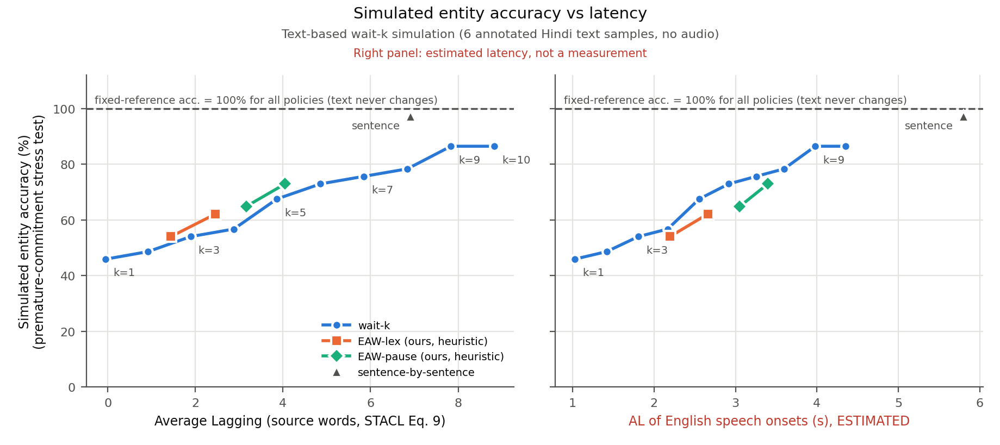
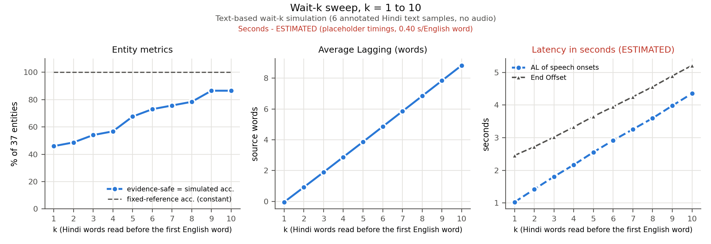
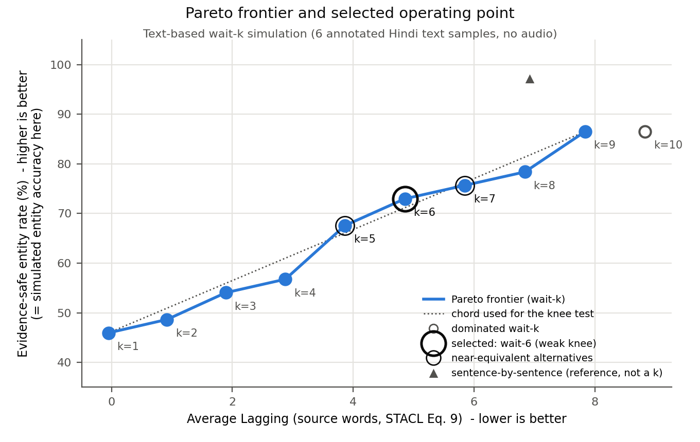

# Where should a Hindi–English simultaneous translator wait? A text-based wait-k sweep

*Hardik Kumar (Roll No. 2401MC39) · Inter IIT Tech Meet 15.0 · Sarvam.ai mini problem statement, ML track (Part E) · code, tests and RESULTS.md in the project repository*

> **Status of evidence.** This is a *text-based timing simulation* on six annotated Hindi text samples. No recordings exist yet, no translation or speech model was trained or run, and every latency in seconds is an **estimate** from placeholder timings (not measured). The 30-boundary audio alignment audit is still pending. Transcripts are scripted (not yet verified against audio) and the English references are LLM drafts pending human review.

## 1. Objective and problem framing

The Sarvam task streams code-mixed Hindi speech in and English speech out. Spoken English cannot be taken back, and the system is scored on both entity accuracy (amounts, numbers, names, negation, corrections) and latency. Hindi is verb-final, and speakers correct themselves ("पाँच लाख… नहीं नहीं, पाँच करोड़"), so speaking too early commits to words whose deciding evidence has not been heard yet. Waiting longer costs latency. **Objective:** sweep the wait-k policy over k = 1…10 on our annotated samples, measure the accuracy–latency trade-off with metrics that are honest about what a text simulation can show, and choose an operating point with an explicit, reproducible rule.

## 2. Relevant research: STACL and Hibiki

**From the papers. STACL [2]** introduces prefix-to-prefix training and the *wait-k* policy: the model reads k source words, then alternates one target word per source word, always k words behind. Its read schedule is g(t) = min(k + t − 1, |x|) (Eq. 6), the number of source words read before target word t. STACL also defines *Average Lagging* (Eq. 9): AL = (1/τ) Σ_{t≤τ} [g(t) − (t−1)/r], where r = |y|/|x| and τ is the first t at which g(t) = |x|. AL is in source words, and AL = k when |x| = |y|. SimulEval [3] applies the same formula to time delays (seconds).

**Hibiki [4]** (French→English speech-to-speech) does *not* use a fixed k. Its *contextual alignment* finds, for each target word, the source word whose arrival most increases that word's log-likelihood under an off-the-shelf translation model (MADLAD-3B, fed truncated source prefixes). It then builds training targets that lag this alignment by at least δ_ctx = 2 s, inserting silence or using alignment-aware TTS. In its ablation, a constant 2 s lag reaches ASR-BLEU 10.0 at LAAL 2.49 s, while contextual alignment reaches 26.6 at LAAL 5.0 s (sentence alignment: 25.6 at 21.49 s). Our reading of that table: *where* the wait is placed matters, not only how long it is.

**Our implementation (what differs).** We implement and evaluate **wait-k only**, plus our own heuristic entity-aware waiting (EAW) variants as a secondary comparison. We do **not** reproduce Hibiki. We run no translation model, compute no likelihood differences and train nothing. Hibiki is the inspiration for one design choice: each annotated entity records the Hindi word that determines it (`src_idx`), a hand-made, entity-only analogue of "the source word that makes the target word predictable".

## 3. Dataset: the six existing Hindi text samples

Six scripted code-mixed Hindi passages (`data/annotations/clips.json`) contain 377 Hindi words and 366 English reference words. They have 37 hand-annotated entities: 13 name, 11 negation, 7 amount, 4 correction, 2 digits. Each entity records (i) its determining Hindi word index, e.g. करोड़ in "पाँच करोड़" or the corrected digit; (ii) the index of its first English word; and (iii) a hand-written *premature guess*, the best English available from the prefix ("five lakh"), or `<unk>` for an unheard name. **Assumption:** source word timings are placeholder estimates computed from character counts (clips of about 22–26 s). Each English word lasts a fixed 0.40 s. Compute and TTS latency are 0 because nothing was run. Statuses remain `pending_recording`, `scripted_unverified` and `llm_draft_unreviewed`.

## 4. Method and evaluation setup

- **Simulation.** The English text is the fixed fluent reference, and only its release times change with k. Every k uses the same clips, tokenisation, references, entity annotations, checker and conventions. A source word counts as read at its end time. The last English word waits for the full source (EOS), and English speech queues behind itself (Sarvam's playback rule: a word starts when decided or when the previous one ends, whichever is later).
- **(1) Fixed-reference entity accuracy:** the checker on the unmodified reference. It is identical for every k by construction.
- **(2) Evidence-safe rate:** the share of entities committed after their determining Hindi word was read. This is a *proxy* for whether enough evidence was available, not proof that a model would produce the right word.
- **(3) Simulated entity accuracy (stress test, not a model):** an entity committed early is replaced by its premature guess, and the checker re-scores the text. Every annotated guess fails the checker, so (3) equals (2) here (true for all 16 policies).
- **(4) AL in source words** (STACL Eq. 9), averaged over clips.
- **(5) Latency in seconds (estimated):** SimulEval AL of English speech onsets and End Offset (output end minus source end).
- **Selection rule** (implemented in `src/sweep.py`). The candidates are wait-1…wait-10. (a) Pareto frontier on (max evidence-safe rate, min AL in words): a point is dominated if another has at least the same rate and no greater AL, with one strict. (b) Knee: after min-max normalisation, the frontier point with the largest distance above the chord joining the frontier's extremes; ties go to the smaller k. The knee is flagged *weak* when that distance is smaller than one entity flipping (1/37 of the rate). (c) Secondary sensitivity: utility = α·rate_norm + (1−α)·(1 − AL_norm) for α = 0.1…0.9. α is a preference weight, not a constant.

## 5. Results: the k sweep

| Policy | AL (words) | AL onset (s) (estimated) | End Offset (s) (estimated) | Evidence-safe | Simulated acc. | Fixed-ref. acc. |
|---|---|---|---|---|---|---|
| wait-1 | -0.05 | 1.03 | 2.46 | 46.0% | 46.0% | 100.0% |
| wait-2 | 0.92 | 1.42 | 2.72 | 48.6% | 48.6% | 100.0% |
| wait-3 | 1.89 | 1.81 | 3.02 | 54.0% | 54.0% | 100.0% |
| wait-4 | 2.88 | 2.17 | 3.33 | 56.8% | 56.8% | 100.0% |
| wait-5 | 3.86 | 2.56 | 3.65 | 67.6% | 67.6% | 100.0% |
| wait-6 | 4.86 | 2.92 | 3.95 | 73.0% | 73.0% | 100.0% |
| wait-7 | 5.85 | 3.26 | 4.25 | 75.7% | 75.7% | 100.0% |
| wait-8 | 6.84 | 3.60 | 4.56 | 78.4% | 78.4% | 100.0% |
| wait-9 | 7.84 | 3.98 | 4.89 | 86.5% | 86.5% | 100.0% |
| wait-10 | 8.83 | 4.35 | 5.21 | 86.5% | 86.5% | 100.0% |
| EAW-lex k=2 | 1.44 | 2.20 | 3.57 | 54.0% | 54.0% | 100.0% |
| EAW-lex k=3 | 2.46 | 2.66 | 3.93 | 62.2% | 62.2% | 100.0% |
| EAW-pause k=2 | 3.16 | 3.05 | 4.28 | 64.9% | 64.9% | 100.0% |
| EAW-pause k=3 | 4.05 | 3.40 | 4.56 | 73.0% | 73.0% | 100.0% |
| sentence-by-sentence | 6.92 | 5.80 | 7.94 | 97.3% | 97.3% | 100.0% |

*Table 1. Means over 6 clips (latency); entity rates pooled over 37 entities. EAW = our heuristic variants. Whole-clip baseline (not shown): AL 62.83 words, 100.0% evidence-safe. Source: results/metrics_aggregate.csv.*

**Observed.** Fixed-reference accuracy is **100.0% for every k**, so it cannot discriminate between policies. From wait-1 to wait-10, the evidence-safe rate rises from 46.0% to 86.5%, while AL grows almost linearly, by about one source word per step (-0.05 → 8.83). wait-10 adds latency with no safety gain over wait-9.

*Figure 1. Simulated entity accuracy vs AL in words (left, timing-independent) and vs the estimated AL of English speech onsets (right, placeholder timings). The dashed line is the fixed-reference accuracy, which is the same for every policy.*

*Figure 2. Each metric against k. The entity rates and AL in words do not depend on timings; the seconds panel is estimated.*

## 6. Operating-point selection

*Figure 3. Pareto frontier of the wait-k sweep (filled = non-dominated, hollow = dominated), the chord used for the knee test, the selected point and its alternatives. Generated from results/metrics_aggregate.csv.*

- **Pareto frontier:** k = 1, 2, 3, 4, 5, 6, 7, 8, 9; dominated: k = 10.
- **Selected (knee): wait-6**, with an evidence-safe rate of 73.0%, AL 4.86 source words, and an estimated AL onset of 2.92 s. Compared with wait-1, AL rises by 4.91 words and evidence-safe by 27.0 points.
- **Near-equivalent alternatives:** wait-5 (67.6%, AL 3.86); wait-7 (75.7%, AL 5.85).
- **The knee is weak:** its distance above the chord (0.0295) is smaller than the effect of one entity flipping (0.0667). The curve is close to linear, so the data do not single out one k.
- **Sensitivity:** α=0.1→k=1, α=0.2→k=1, α=0.3→k=1, α=0.4→k=1, α=0.5→k=6, α=0.6→k=9, α=0.7→k=9, α=0.8→k=9, α=0.9→k=9. The selected k switches abruptly (k=1→k=6 at α=0.5; k=6→k=9 at α=0.6) instead of drifting gradually, which is the signature of a near-linear trade-off. On the estimated seconds axis the knee is again wait-6.
- **Reference policies:** on AL in words, EAW-lex k=2 dominates wait-3; EAW-lex k=3 dominates wait-4; EAW-pause k=3 dominates wait-6; sentence-by-sentence dominates wait-9, 10. On estimated seconds, none dominate, because EAW-pause pays for observed pauses and sentence-level output queues long English speech.

**Interpretation.** We recommend **wait-6 as the nominal operating point, with wait-5–wait-7 as an equivalent band** and a starting point for tuning on real audio. This is a preference on a near-linear curve, not an optimum. Safety per category explains why fixed k is blunt. Under wait-3, corrections are 0/4 safe and negations 5/11; under wait-6, they are 1/4 and 8/11. Negation needs the clause-final Hindi verb, and no small fixed k reliably reaches it. This is the content-dependent waiting that Hibiki's contextual alignment learns from data.

## 7. Limitations and next steps

- **Not a model measurement.** The reference translation is fixed, so a prefix-to-prefix model's real errors, both hallucinated anticipation and good anticipation, are not captured. Rates (2) and (3) are proxies.
- **Small sample.** Six scripted text samples, one author, 37 entities: one entity is 2.7 points, so adjacent k values are not statistically distinguishable. The premature guesses and `src_idx` labels are the author's own.
- **Seconds are estimates.** Real word durations, pauses, English TTS durations, compute latency and playback queues will change the seconds axis. Longer real TTS words would raise the onset AL and End Offset for every k, and most of all for large k and sentence-level output. Word-based AL and the evidence-safe rate will change only if transcripts change.
- **Pending requirements:** six natural recordings (20–40 s), verbatim transcripts verified against audio, forced alignment, the 30-boundary manual audit, and human review of the translations and checker labels.
- **Future work:** re-run the sweep on aligned recordings; replace fixed k with a target-triggered or contextual-alignment (Hibiki-style) policy using a small MT model's likelihood gains; evaluate a real streaming model's output with the same checker.

## References

[1] Sarvam AI. Inter IIT Tech Meet 15.0 problem statement and Sarvam.ai mini problem statement (provided PDFs).  
[2] M. Ma et al. STACL: Simultaneous Translation with Implicit Anticipation and Controllable Latency using Prefix-to-Prefix Framework. ACL 2019, pp. 3025–3036 (Eq. 6 wait-k, Eq. 9 Average Lagging).  
[3] X. Ma, M. J. Dousti, C. Wang, J. Gu, J. Pino. SimulEval: An Evaluation Toolkit for Simultaneous Translation. EMNLP 2020 System Demonstrations, pp. 144–150; ALScorer in simuleval/evaluator/scorers/latency_scorer.py.  
[4] T. Labiausse, L. Mazaré, E. Grave, A. Défossez, N. Zeghidour. High-Fidelity Simultaneous Speech-To-Speech Translation (Hibiki). ICML 2025, PMLR 267 (Sec. 3.2 contextual alignment; Table 4 ablation).  
[5] S. Papi, M. Gaido, M. Negri, M. Turchi. Over-Generation Cannot Be Rewarded: Length-Adaptive Average Lagging (LAAL). AutoSimTrans 2022, pp. 12–17.  
